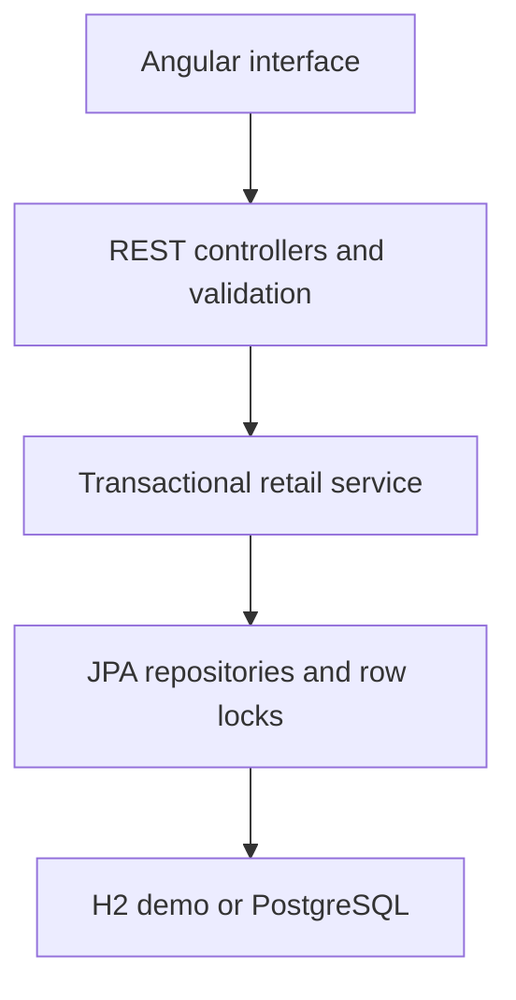

# RetailFlow — Retail Order & Inventory Management

A portfolio project by **Sai Srinath**: a working Java + Angular application for retailer ordering, inventory reservation, and fulfillment tracking.

This is an independent demonstration project inspired by retail enterprise workflows. It is not an employer's system, and its sample data and metrics are not production claims.

## What you can do

- View a dashboard of booked order value, orders, product count, and low-stock products.
- Search an eight-product catalog by product name or SKU; filter by category.
- Build a multi-item order for a fictitious retailer.
- Reserve inventory when placing an order. Prices and totals are calculated on the server.
- Advance orders through PLACED → CONFIRMED → SHIPPED → DELIVERED.
- Cancel PLACED or CONFIRMED orders and return reserved inventory exactly once.
- View order lines, original prices, and timestamped status history.
- Restock a product by 20 units in the UI; choose a quantity in the API.
- Retry order creation safely with the same idempotency key.

## Stack

Java 17 · Spring Boot 3.5.16 · Spring Data JPA · Bean Validation · Angular 20.3.34 / TypeScript · H2 / PostgreSQL · JUnit 5 / MockMvc · Docker · GitHub Actions.

## Start here

1. **[SETUP.md](docs/SETUP.md)** — Windows, IntelliJ, local run, and Docker.
2. **[GITHUB-AND-DEPLOY.md](docs/GITHUB-AND-DEPLOY.md)** — push to your new GitHub account and publish.
3. **[LEARNING-GUIDE.md](docs/LEARNING-GUIDE.md)** — understand and explain the code.
4. **[API.md](docs/API.md)** — endpoint contracts and business rules.
5. **[VALIDATION.md](docs/VALIDATION.md)** — verification results and remaining limits.

## Quick run (Java 17+, Maven 3.9+, Node 22.12+)

Terminal 1:
```sh
cd backend
mvn spring-boot:run
```
Terminal 2, from a separate terminal in the project root:
```sh
cd frontend
npm ci
npm start
```
Open http://localhost:4200. The Angular development proxy forwards API requests to port 8080.

Alternatively, install Docker Desktop, copy `.env.example` to `.env`, set your own password, then run:
```sh
docker compose up --build
```
Open http://localhost:8080. This path uses PostgreSQL and retains data in a named Docker volume.

## Architecture



The single Docker image compiles Angular into Spring Boot's static resources. One origin serves the UI and API, so production CORS configuration is unnecessary. H2 keeps the first run simple; the postgres profile uses an external database.

## Business decisions

- Money uses `BigDecimal` with database decimal columns. The frontend display is informational; server totals are authoritative.
- Order lines snapshot product name and unit price.
- Product locks are acquired in ascending ID order to reduce deadlock risk.
- A transaction wraps reservation and order persistence; failed orders roll back their inventory changes.
- `Idempotency-Key` is unique in the database. Replays must match the original retailer and normalized product quantities. Simultaneous duplicate inserts may return 409; retry the same key to retrieve the winner.
- Order row locking serializes competing fulfillment/cancellation changes.
- Delivered/shipped orders cannot be cancelled; cancelled/delivered orders are terminal.
- Booked value is the sum of non-cancelled orders, not accounting revenue.

## Project layout

```text
backend/                 Spring Boot API, persistence, integration tests
frontend/                Angular application and locked npm dependencies
docs/                    setup, API, learning and deployment guides
postman/                 importable API collection
.github/workflows/       build and test on every push / pull request
Dockerfile               multi-stage UI + backend image
compose.yml              local app + PostgreSQL
```

## Scope and honest limitations

This is an intentionally open, shared sandbox. There is no authentication, tenant isolation, payment processing, shipping provider, tax calculation, Kafka, or Redis. Never enter real customer information. Anyone visiting the demo can modify its sample inventory/orders. In-memory demo data is lost on restart. There is no pagination or rate limiting; keep this to portfolio-scale traffic.

The postgres profile currently uses Hibernate `ddl-auto: update` for convenience. A production rollout should use versioned migrations (Flyway/Liquibase), authentication/authorization, audit identities, pagination, monitoring, and backed-up persistent storage. The order activity log records status/time only and is not a compliance audit trail.

Kafka, Redis, JWT roles, and a transactional outbox are documented as future learning tasks, not implemented features.

## Demo script (3 minutes)

1. Open Overview and explain the four live metrics.
2. Open Product catalog; search `coffee` and clear the search.
3. Add two coffee packs and one bottle to an order for `Maple Street Market`.
4. Place the order; show the reduced stock and new order.
5. Confirm → Ship → Deliver. Open the order to show its activity history.
6. Create a second order and cancel it; show that inventory is restored.
7. Explain one integration test and the locking/idempotency tradeoffs.

## Resume description — use after running and understanding the project

**RetailFlow | Personal project | Java, Spring Boot, Angular, PostgreSQL, Docker**

- Developed a retailer ordering and inventory application with REST APIs, a responsive Angular operations console, and transactional stock reservation.
- Implemented an order state machine, cancellation/restocking, server-side price calculation, request idempotency, and integration tests for business rules.
- Configured GitHub Actions build checks and containerized deployment of the frontend and backend.

Add your actual deployment link and test results after verifying them. Do not describe this as client work.
